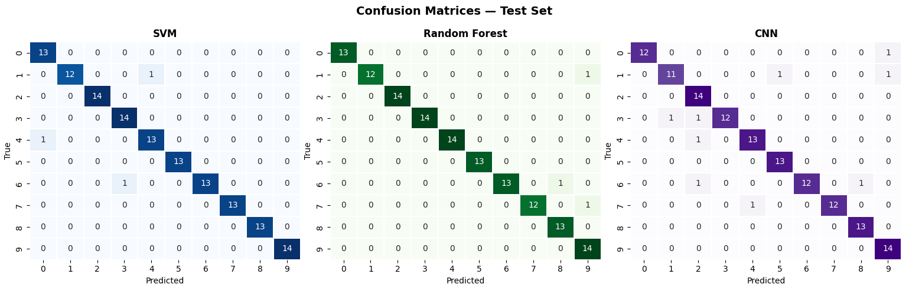
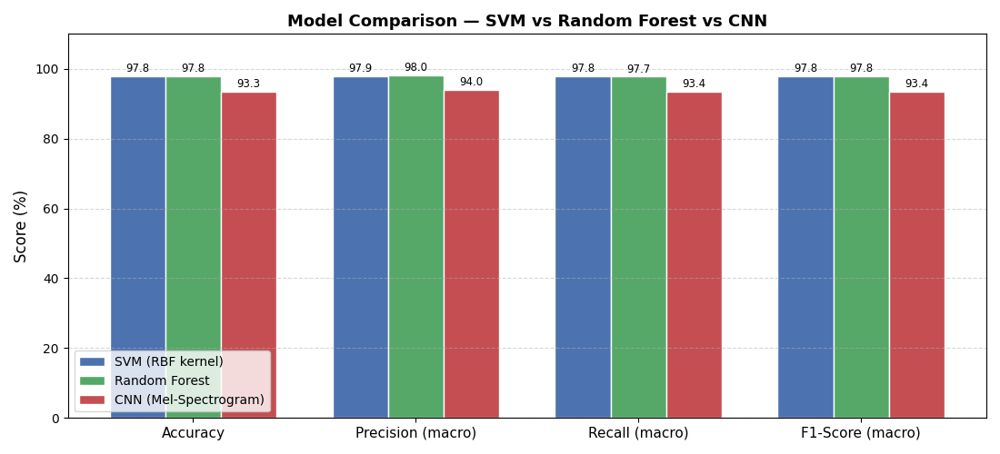
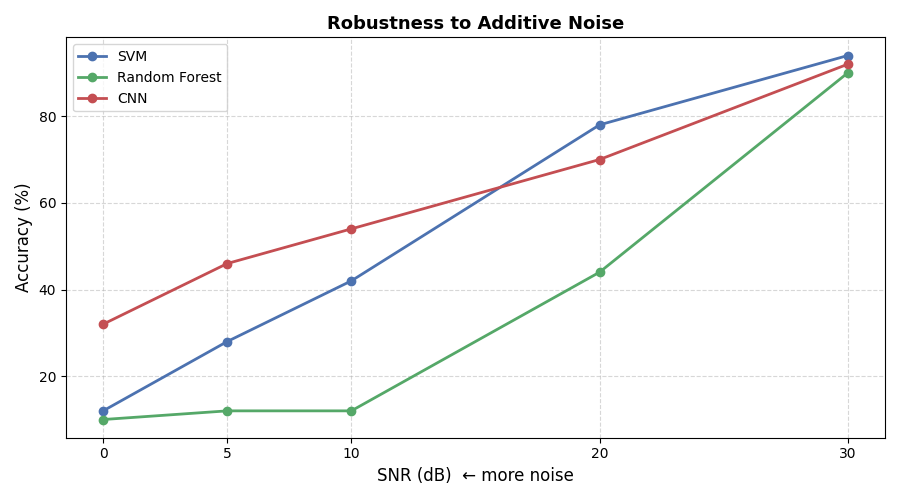
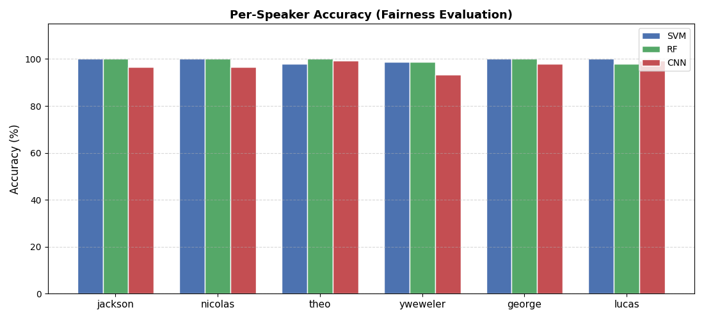
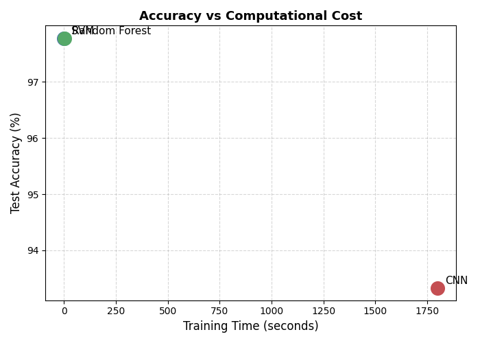

# Automatic Spoken Digit Recognition (ASDR)

**Author:** Pranav Sri Vasthav Tenali Gnana  
**Course:** Speech Understanding, M.Tech, IIT Jodhpur

A complete pipeline for recognising spoken digits (0–9) that compares classical machine learning with deep learning on the same data:

- **Classical ML:** SVM (RBF kernel) and Random Forest, trained on MFCC features (mean + std)
- **Deep learning:** a CNN trained on Mel-spectrograms, with SpecAugment-style time and frequency masking

Beyond accuracy, the models are also tested for **robustness to noise** (additive white Gaussian noise at varying SNR) and **fairness across speakers** (per-speaker accuracy).

**Dataset:** [Free Spoken Digit Dataset (FSDD)](https://github.com/Jakobovski/free-spoken-digit-dataset), 8 kHz recordings from 6 speakers. It is downloaded automatically on the first run.

---

## Project Structure

```
spoken-digit-recognition-mfcc-cnn/
├── main.py             # End-to-end pipeline entry point
├── config.py           # Constants, hyperparameters and output folder
├── data_loader.py      # FSDD download and dataset loading
├── features.py         # Silence trimming, pre-emphasis, MFCC and Mel-spectrogram extraction
├── train_classical.py  # SVM and Random Forest training
├── train_cnn.py        # CNN architecture, augmentation and training
├── evaluate.py         # Metrics, confusion matrices, comparison plots
├── robustness.py       # Noise robustness evaluation (AWGN at varying SNR)
├── fairness.py         # Per-speaker accuracy (fairness) evaluation
├── visualize.py        # EDA, waveform, feature and CNN activation plots
├── outputs/            # Figures produced by a full run
├── requirements.txt
└── README.md
```

---

## Setup

```bash
git clone https://github.com/Pranav-Sri-Vasthav-Tenali-Gnana/spoken-digit-recognition-mfcc-cnn
cd spoken-digit-recognition-mfcc-cnn

python -m venv venv
source venv/bin/activate        # Linux / macOS
venv\Scripts\activate           # Windows

pip install -r requirements.txt
```

> **Note:** TensorFlow requires Python 3.8–3.11. If you have a GPU, install `tensorflow[and-cuda]` instead.

---

## Running

```bash
python main.py
```

The pipeline:
1. Downloads FSDD into `fsdd_recordings/`
2. Runs exploratory analysis (class balance, waveforms, feature plots)
3. Extracts MFCC and Mel-spectrogram features, with a stratified 70 / 15 / 15 train / validation / test split
4. Trains the SVM, Random Forest and CNN models
5. Evaluates and compares them (accuracy, precision, recall, F1, training time)
6. Runs the noise-robustness and per-speaker fairness analyses
7. Saves every figure to `outputs/` and prints a final results table

---

## System Workflow

```
Audio input (spoken digits 0–9)
        ↓
Preprocessing (silence trimming, pre-emphasis)
        ↓
Feature extraction
   ├── MFCC (mean + std) → SVM, Random Forest
   └── Mel-spectrogram   → CNN
        ↓
Model training
   ├── SVM (RBF kernel)
   ├── Random Forest
   └── CNN (with SpecAugment)
        ↓
Evaluation (accuracy, precision, recall, F1, robustness, fairness)
```

---

## Results

All figures are in [`outputs/`](outputs).

| Figure | Description |
|---|---|
| `fig1_class_distribution.png` | Number of samples per digit |
| `fig2_waveforms.png` | Example waveform for each digit |
| `fig3_feature_representations.png` | MFCC and Mel-spectrogram of a sample |
| `fig4_cnn_training_history.png` | CNN loss and accuracy curves |
| `fig5_model_comparison_bar.png` | Accuracy / precision / recall / F1 for each model |
| `fig6_accuracy_vs_cost.png` | Accuracy vs training time |
| `fig7_confusion_matrices.png` | Confusion matrix for each model |
| `fig8_noise_robustness.png` | Accuracy under decreasing SNR |
| `fig9_per_speaker_fairness.png` | Accuracy per speaker |
| `fig10_cnn_activation_maps.png` | CNN convolution-layer activation maps |

| Model comparison | Accuracy vs training cost |
|---|---|
|  |  |

| Noise robustness | Per-speaker fairness |
|---|---|
|  |  |



---

## References

1. Sen et al., CNN based spoken digit recognition, 2021.
2. Rakshith et al., MFCC based spoken digit system, 2021.
3. Nasr-Esfahani et al., CNN-BiGRU spoken digit recognition, 2024.
4. Jakobovski, Free Spoken Digit Dataset (FSDD), GitHub.
5. McFee et al., librosa: Audio and Music Signal Analysis in Python, 2015.
